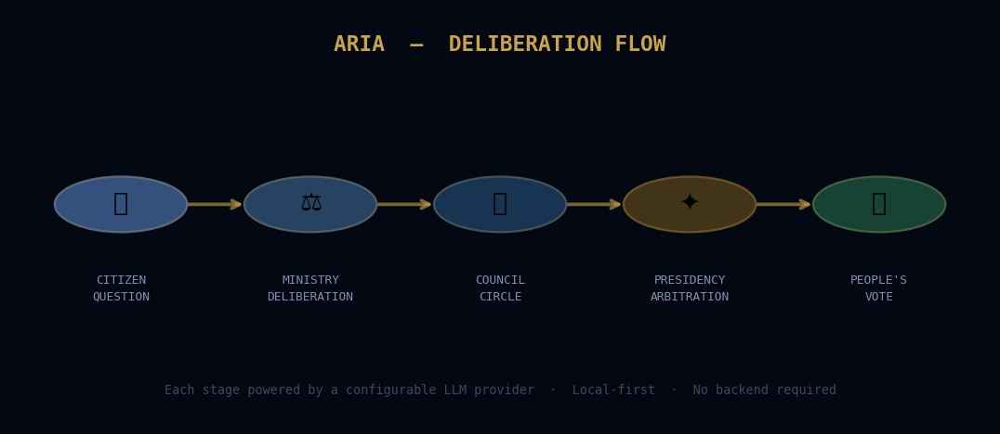
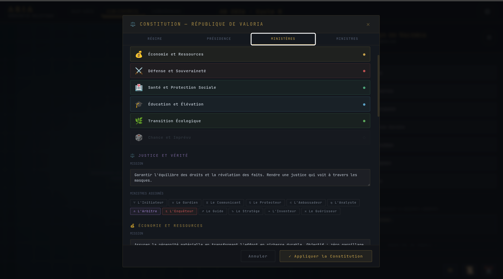
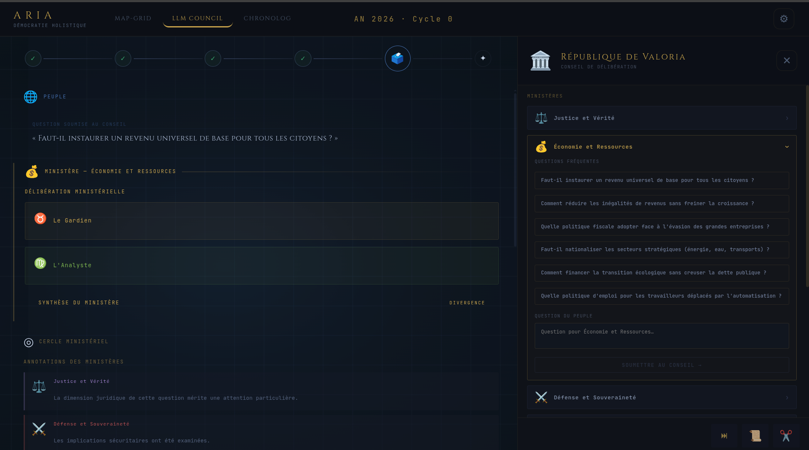
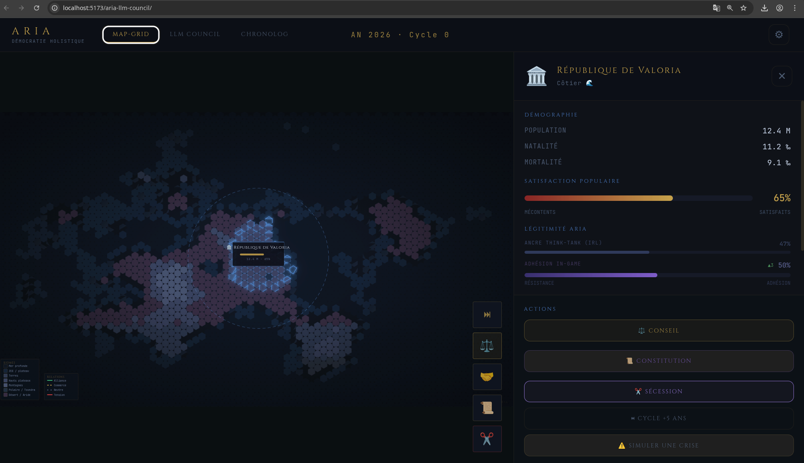

<div align="center">

# ARIA

**Architecture de Raisonnement Institutionnel par IA**

*Et si les politiques d'un pays étaient soumises au peuple, par l'intermédiaire d'un conseil des ministres IA ?*

[](https://react.dev)
[](https://vite.dev)
[](LICENSE)
[](https://flodus.github.io/aria-llm-council)

**[🚀 Lancer la démo](https://flodus.github.io/aria-llm-council)** · **[🇬🇧 English version](README.md)**

</div>

---

## Ce qu'est ARIA

ARIA est une **simulation de gouvernance systémique**. Vous incarnez le peuple souverain. Un conseil de ministres, incarné par des modèles de langage, délibère sur chaque question que vous soumettez. Les ministères débattent, une présidence arbitre, et le peuple vote. Chaque décision est consignée et nourrit le cycle suivant.

C'est un bac à sable politique et une expérience de pensée sur la gouvernance algorithmique et la co-décision humain-IA. Il fonctionne aussi entièrement hors ligne, sans aucune IA, en mode **Board Game**.



| Réglages constitutionnels | Délibération du conseil | Carte géopolitique |
| :---: | :---: | :---: |
|  |  |  |

*[Galerie complète des captures →](doc/screenshots/)*

---

## Documentation

Un guide de la simulation, en français et en anglais, en page web et en PDF.

| Document | Web | PDF |
| --- | --- | --- |
| **La Simulation** | [FR / EN](https://flodus.github.io/aria-llm-council/docs/aria-simulation.html) | [FR](doc/pdf/ARIA-simulation-FR.pdf) · [EN](doc/pdf/ARIA-simulation-EN.pdf) |

Le texte de vision d'origine reste disponible : [Manifeste (FR, PDF)](doc/ARIA_Manifeste_FR.pdf) · [Manifesto (EN, PDF)](doc/ARIA_Manifesto_EN.pdf).

---

## Comment une décision se prend

| Étape | Qui | Assuré par |
|---|---|---|
| **Question** | Le peuple soumet une question | Humain |
| **Délibération des ministères** | Deux ministres par ministère argumentent depuis leurs prompts | Modèle de langage (configurable) |
| **Annotations croisées** | Chaque ministère annote les synthèses des autres | Modèle de langage (configurable) |
| **Synthèse présidentielle** | Le Phare et la Boussole arbitrent | Modèle de langage (configurable) |
| **Vote** | Le peuple décide ; la satisfaction et le score ARIA évoluent | Moteur de simulation |

En **mode crise**, tous les ministères délibèrent en parallèle et la présidence est court-circuitée. La Destinée (l'Oracle et la Trame) peut ajouter des voix philosophiques à la synthèse finale.

---

## Modes et fournisseurs

ARIA fonctionne selon l'un des trois modes IA, choisi au démarrage :

| Mode | Ce qu'il fait |
|---|---|
| **ARIA** | Plusieurs fournisseurs orchestrés, un par rôle |
| **SOLO** | Un seul fournisseur pour tous les rôles, pour une voix cohérente |
| **CUSTOM** | Assignation rôle par rôle |

Le mode **Board Game** ne demande ni IA ni clé d'API : tout le contenu est dans des fichiers JSON, avec un miroir anglais complet.

Fournisseurs supportés : **Claude** (Anthropic), **Gemini** (Google), **Grok** (xAI), **OpenAI** et **OpenRouter** (une passerelle vers de nombreux modèles). Les modèles par défaut sont définis dans [`src/shared/constants/models.js`](src/shared/constants/models.js). Vos clés restent dans votre navigateur.

---

## Fonctionnalités

- **Conseil des ministres** : 12 ministres, 7 ministères, deux présidents à égalité (le nombre est modifiable).
- **Constitutions** : changer le régime, la présidence, les ministères et les prompts d'un pays, en cours de partie.
- **Douze régimes politiques**, chacun avec son ton et son multiplicateur de satisfaction.
- **Mondes** : pays réels ou nations fictives, jusqu'à six à la fois, sur un globe 3D.
- **Chronolog** : une mémoire publique des votes, sécessions, changements de constitution et diplomatie, avec une mémoire narrative par pays.
- **Sécession** : un groupe peut partir et fonder une nouvelle nation avec ses propres prompts.
- **Destinée du Monde** : l'Oracle et la Trame interviennent dans les crises existentielles.
- **Interface bilingue** : français et anglais.

---

## Démarrer

**Prérequis :** Node.js 18 ou plus récent, et au moins une clé d'API pour le mode LLM.

```bash
git clone https://github.com/flodus/aria-llm-council.git
cd aria-llm-council
npm install
npm run dev
```

Ouvrez **http://localhost:5173/aria-llm-council/** (le préfixe correspond à la base de production). L'écran d'accueil guide la configuration du monde et des clés d'API.

Autres scripts : `npm run build` (build de production dans `dist/`), `npm run preview`, `npm run lint`.

---

## Structure du projet

```
aria-llm-council/
├── src/
│   ├── App.jsx                 # Coque de l'application
│   ├── ariaI18n.js             # Traductions FR / EN
│   ├── features/
│   │   ├── init/               # Écran d'accueil : monde, clés d'API
│   │   ├── world/              # Boucle de jeu, panneau pays, modales
│   │   ├── council/            # Moteur de délibération et interface du conseil
│   │   ├── map/                # Globe 3D (mondes réel et fictif)
│   │   ├── chronolog/          # Journal d'historique et Chroniqueur
│   │   └── settings/           # Réglages
│   └── shared/
│       ├── services/           # Clients LLM, clés de stockage
│       ├── data/               # Pays, régimes, données statiques
│       ├── theme/              # Tokens de design
│       └── constants/          # Modèles, équilibrage du jeu
├── templates/languages/        # Contenu éditorial (JSON), FR et EN
├── public/docs/                # Versions web de la documentation
├── doc/                        # Vision, feuille de route, backlog, PDF
└── server.js                   # Dormant : base du futur multijoueur
```

---

## Notes d'architecture

**Local d'abord.** Chaque appel d'API part directement du navigateur vers le fournisseur. Pas de compte, pas de collecte de données.

**État dans le navigateur.** L'état de la simulation est gardé en mémoire et sauvegardé dans `localStorage`. Chaque appel de modèle reçoit le contexte dont il a besoin.

**Contenu éditorial en JSON.** Les questions, réponses de ministres, synthèses et annotations sont des données, pas du code. Le mode Board Game les utilise directement ; le mode LLM s'appuie dessus.

---

## Feuille de route

La feuille de route complète est dans [doc/ROADMAP.fr.md](doc/ROADMAP.fr.md), le backlog quotidien dans [doc/TODO.md](doc/TODO.md). Les priorités en cours : la génération procédurale de la carte, le protocole de crises aléatoires, la sécession assistée et les bases du multijoueur.

---

## Contribuer

Les signalements et les pull requests sont bienvenus. Voir [CONTRIBUTING.fr.md](CONTRIBUTING.fr.md) pour les règles, et [CONTRIBUTING.md](CONTRIBUTING.md) en anglais.

---

## Remerciements

La logique d'orchestration d'agents d'ARIA prolonge **[llm-council d'Andrej Karpathy](https://github.com/karpathy/llm-council)**. Merci à Andrej pour ce projet.

La méthode de gouvernance s'appuie sur le cadre Assess, Decide, Do de Dragos Roua.

Le code est le produit d'une collaboration entre un auteur humain, qui a défini la vision, la logique constitutionnelle et l'expérience, et des agents d'IA : Gemini pour le raisonnement stratégique et la structure, Claude pour l'implémentation.

---

## Licence

MIT, voir [LICENSE](LICENSE).
