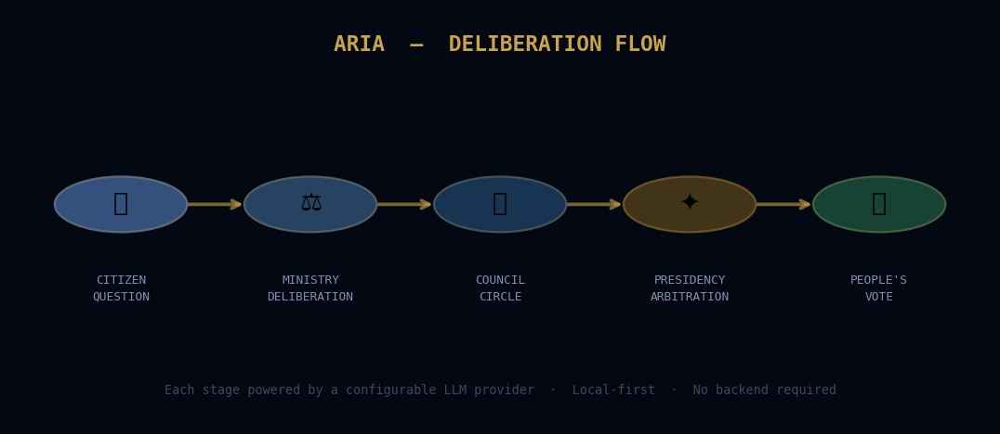
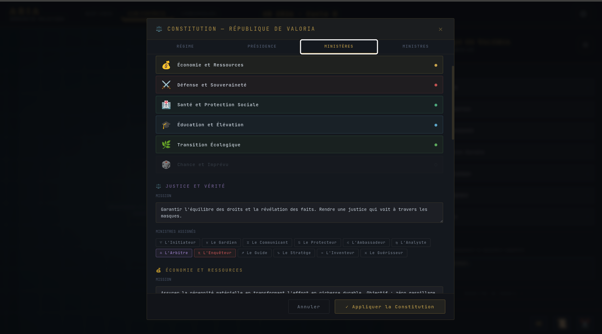
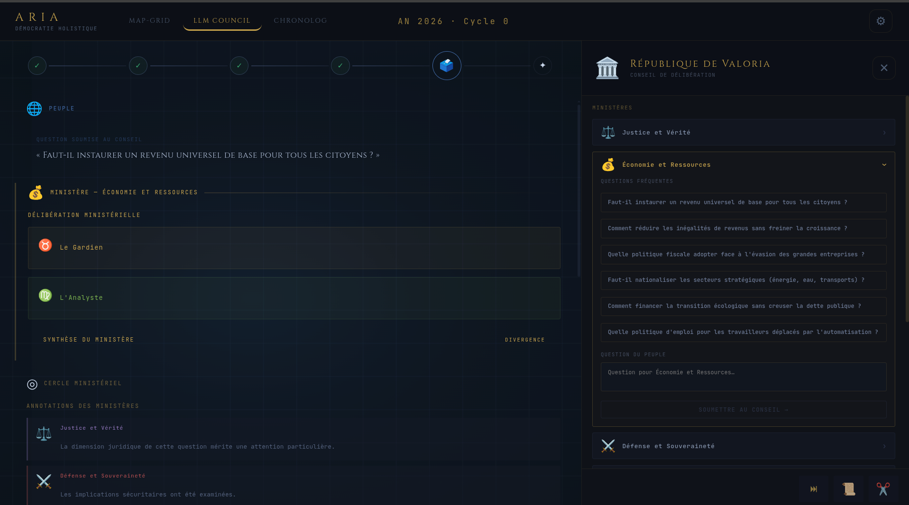
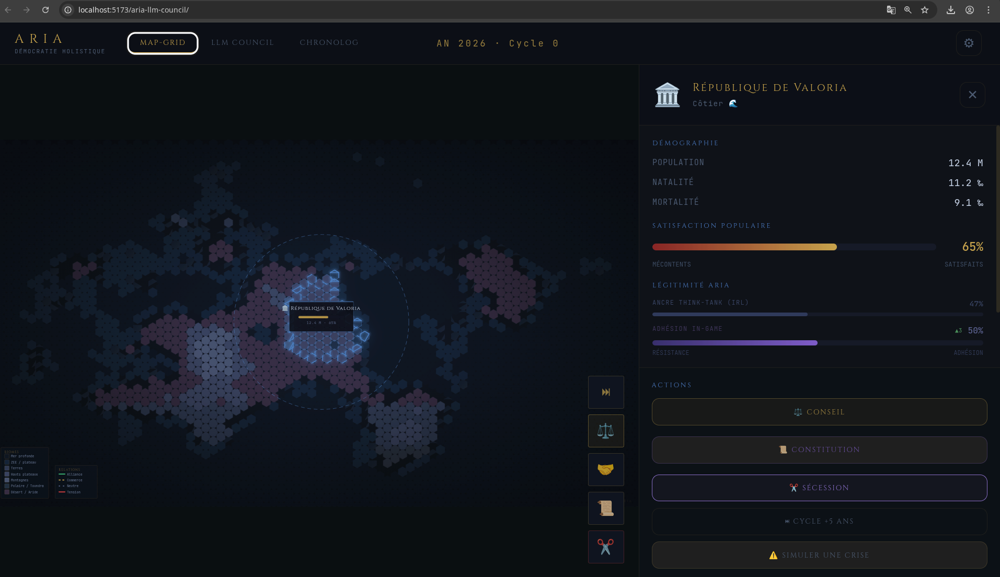

<div align="center">

# ARIA

**Institutional Reasoning Architecture via AI**

*What if a nation's policies were submitted to the people through an AI-powered Council of Ministers?*

[](https://react.dev)
[](https://vite.dev)
[](LICENSE)
[](https://flodus.github.io/aria-llm-council)

**[🚀 Launch the demo](https://flodus.github.io/aria-llm-council)** · **[🇫🇷 Version française](README.fr.md)**

</div>

---

## What ARIA is

ARIA is a **systemic governance simulation**. You play the sovereign people. A Council of Ministers, embodied by language models, deliberates on each question you submit. Ministries debate, a presidency arbitrates, and the people vote. Every decision is recorded and feeds the next cycle.

It is a political sandbox and a thought experiment on algorithmic governance and human-AI co-decision. It also runs fully offline, with no AI at all, in **Board Game** mode.



| Constitutional setup | Council deliberation | Geopolitical map |
| :---: | :---: | :---: |
|  |  |  |

*[Full screenshot gallery →](doc/screenshots/)*

---

## Documentation

A guide to the simulation, in French and English, as a web page and as a PDF.

| Document | Web | PDF |
| --- | --- | --- |
| **The Simulation** | [FR / EN](https://flodus.github.io/aria-llm-council/docs/aria-simulation.html) | [FR](doc/pdf/ARIA-simulation-FR.pdf) · [EN](doc/pdf/ARIA-simulation-EN.pdf) |

---

## How a decision is made

| Stage | Who | Powered by |
|---|---|---|
| **Question** | The people submit a question | Human |
| **Ministry deliberation** | Two ministers per ministry argue from their prompts | Language model (configurable) |
| **Cross-annotation** | Each ministry annotates the others' syntheses | Language model (configurable) |
| **Presidential synthesis** | The Lighthouse and the Compass arbitrate | Language model (configurable) |
| **Vote** | The people decide; satisfaction and the ARIA score move | Simulation engine |

In **crisis mode**, all ministries deliberate in parallel and the presidency is bypassed. Destiny (the Oracle and the Weave) can add philosophical voices to the final synthesis.

---

## Modes and providers

ARIA runs in one of three AI modes, chosen at startup:

| Mode | What it does |
|---|---|
| **ARIA** | Several providers orchestrated, one per role |
| **SOLO** | One provider for every role, for a single coherent voice |
| **CUSTOM** | Role-by-role assignment |

**Board Game** mode needs no AI and no API key: all content is in JSON files, with a full English mirror.

Supported providers: **Claude** (Anthropic), **Gemini** (Google), **Grok** (xAI), **OpenAI**, and **OpenRouter** (a gateway to many models). Default models are set in [`src/shared/constants/models.js`](src/shared/constants/models.js). Your keys are stored only in your browser.

---

## Features

- **Council of ministers**: 12 ministers, 7 ministries, two presidents on equal footing (the number can be changed).
- **Constitutions**: change a country's regime, presidency, ministries and prompts, during play.
- **Twelve political regimes**, each with its own tone and satisfaction multiplier.
- **Worlds**: real countries or fictional nations, up to six at once, on a 3D globe.
- **Chronolog**: a public record of votes, secessions, constitutional changes and diplomacy, with a narrative memory per country.
- **Secession**: a group can leave and found a new nation with its own prompts.
- **Destiny of the World**: Oracle and Weave intervene in existential crises.
- **Bilingual interface**: French and English.

---

## Getting started

**Requirements:** Node.js 18 or later, and at least one API key if you use LLM mode.

```bash
git clone https://github.com/flodus/aria-llm-council.git
cd aria-llm-council
npm install
npm run dev
```

Open **http://localhost:5173/aria-llm-council/** (the path prefix matches the production base). The start screen guides you through world setup and API configuration.

Other scripts: `npm run build` (production build in `dist/`), `npm run preview`, `npm run lint`.

---

## Project structure

```
aria-llm-council/
├── src/
│   ├── App.jsx                 # Application shell
│   ├── ariaI18n.js             # FR / EN translations
│   ├── features/
│   │   ├── init/               # Start screen: world setup, API keys
│   │   ├── world/              # Game loop, country panel, modals
│   │   ├── council/            # Deliberation engine and council UI
│   │   ├── map/                # 3D globe (real and fictional worlds)
│   │   ├── chronolog/          # History journal and Chroniqueur
│   │   └── settings/           # Settings
│   └── shared/
│       ├── services/           # LLM clients, storage keys
│       ├── data/               # Countries, regimes, static data
│       ├── theme/              # Design tokens
│       └── constants/          # Models, game balance
├── templates/languages/        # Editorial content (JSON), FR and EN
├── public/docs/                # Web versions of the documentation
├── doc/                        # Vision, roadmap, backlog, PDFs
└── server.js                   # Dormant: base for future multiplayer
```

---

## Architecture notes

**Local-first.** Each API call goes from the browser directly to the provider. There is no account and no data collection.

**Persistent state in the browser.** The simulation state is kept in memory and saved in `localStorage`. Each model call receives the context it needs.

**Editorial content in JSON.** Questions, minister answers, syntheses and annotations are data, not code. Board Game mode uses them directly; LLM mode uses them as a base.

---

## Roadmap

The full roadmap is in [doc/ROADMAP.md](doc/ROADMAP.md). The day-to-day backlog is in [doc/TODO.md](doc/TODO.md). Current priorities include a procedural world map, the random crisis protocol, assisted secession, and the multiplayer foundation.

---

## Contributing

Issues and pull requests are welcome. See [CONTRIBUTING.md](CONTRIBUTING.md) for the rules, and [CONTRIBUTING.fr.md](CONTRIBUTING.fr.md) in French.

---

## Acknowledgements

ARIA's agent orchestration extends **[Andrej Karpathy's llm-council](https://github.com/karpathy/llm-council)**. Thank you to Andrej for that project.

The governance method draws on the Assess, Decide, Do framework by Dragos Roua.

The source code is the product of collaboration between a human author, who defined the vision, constitutional logic and experience, and AI agents: Gemini for strategic reasoning and structure, Claude for implementation.

---

## Licence

MIT, see [LICENSE](LICENSE).
